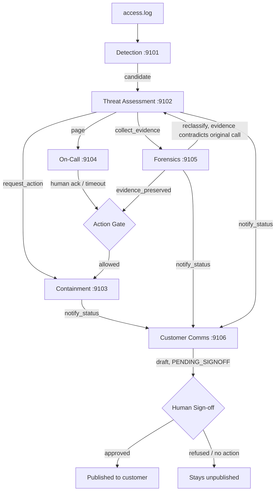

# System Overview — Multi-Agent Crisis Coordination System

This document is self-contained. You do not need to open any other file in this repository to
understand what this project is, how it is built, how it behaves, or what has been proven about it.
Deeper detail on any specific claim is linked at the end, but nothing here depends on reading those
files first.

---

# Part 1 — Plain-Language Overview

## What this is

This is a working prototype of an AI incident-response team for a web application under attack. When
someone attacks a website — guessing passwords, scraping account data, trying SQL injection — six
different AI agent systems notice it, investigate it, decide how serious it is, contain it, notify the
on-call security engineer, write up what happened, decide when it is safe to stand down, and draft a
customer notification — all without a human writing any of that by hand.

The point of the project is not "can an AI write incident reports." It is: **can a chain of AI agents be
given real authority to take real actions (blocking IP addresses, paging a human, publishing a customer
message) safely** — meaning every action that matters is gated, every gate is enforced in code (not
politely requested of the model), a human is required before anything reaches a customer, and there are
two separate audit trails: one that shows a human exactly what happened (scrubbed of sensitive data, safe
to hand to an auditor or a customer), and one that shows an engineer exactly what each AI agent actually
reasoned, word for word, for debugging.

## Why this is interesting

Most "AI agent" demos show a model doing a task. This project's actual thesis is the opposite: it assumes
the model's judgment will sometimes be wrong (confirmed in testing — see Part 6), and asks what it takes
to make a system of such agents *trustworthy anyway*. The answer this project builds is: never let an
agent's own say-so be the thing that authorizes an action. A separate, deterministic, independently-coded
"authority matrix" decides who is allowed to tell whom to do what, a "gate" decides whether an action may
actually execute right now (and if not, whether a human, a timeout, or nothing at all may open it), and a
human is the only thing that can ever let a message reach a real customer. The AI agents do the thinking;
the guardrail code — not another AI agent — decides what, if anything, happens with that thinking.

## What you can watch live

A small target website ("Northwind Cloud") sits in front of a deliberately simple, deliberately insecure
Flask application. Real attack tools (this project's own simulator, and real external tools like `ffuf`,
`gobuster`, `sqlmap`, and others — see Part 6) are run against it. Three live browser views let you watch
the whole thing happen in real time: the raw access log, the raw agent reasoning (including, as of Phase
6.2, a visible "the agent is thinking…" state before each model call resolves), and a scrubbed, audit-grade
trace of every decision the guardrail code made. `docs/DEMO_SCRIPT.md` has the exact steps to run this
yourself.

---

# Part 2 — Architecture and Tech Stack

## The six systems, at a glance

| System | Port | Framework | Job |
|---|---|---|---|
| Detection | 9101 | Google ADK | Watches `access.log`, decides whether a window of traffic is an attack |
| Threat Assessment | 9102 | Google ADK | Enriches with threat intel, classifies severity/type, dispatches |
| Containment / Ops | 9103 | CrewAI | Plans and executes IP blocks, behind a gate |
| On-Call / Escalation | 9104 | CrewAI | Pages a human, is the source of human approval or timeout-escalation |
| Forensics & Recovery | 9105 | CrewAI | Preserves evidence, writes root-cause analysis, plans recovery |
| Customer Communications | 9106 | CrewAI | Drafts customer notices, enforces a human sign-off before publish |

Each system is its own OS process, with its own `/health` endpoint and its own [A2A (Agent-to-Agent)
protocol](https://github.com/google/a2a-python) agent card advertising what it can do. They talk to each
other over real HTTP, not in-process function calls — a system is only ever "aware" of another system
through that protocol, the same way they would be if they were six separately-owned services in
production.

## Why two different agent frameworks

**Google ADK** (Detection, Threat Assessment) is used where the agent's job is a single, well-defined
structured judgment — "is this window an attack," "what severity is this" — with a strict output schema
(a Pydantic model) the rest of the system can trust without parsing free text. ADK's `LlmAgent` +
`FunctionTool` pattern is a clean fit for "reason over this tool's output and return this exact shape."

**CrewAI** (Containment, On-Call, Forensics, Customer Comms) is used where the job benefits from a
reviewer/actioner or assessor/writer *pair* of agents reasoning in sequence (e.g. Containment's
"Situation Reviewer" hands its read to an "Immediate Action Officer" who commits to a decision), or where
the natural unit of work is closer to "write this document" than "answer this one question." CrewAI's
`Agent`/`Task`/`Crew` model fits that shape more naturally than ADK's single-agent-per-call pattern.

Neither framework is used because of a technical requirement the other couldn't meet — it is an
architectural choice made per-system, Phase 1–2, to keep each system's code matching the shape of its
actual job.

## LiteLLM and the cross-provider fallback chain

Every model call in the project — both frameworks — goes through [LiteLLM](https://www.litellm.ai/),
configured with a **fallback chain** per role (`shared/llm.py`): if the primary model (Gemini) is
rate-limited or errors, the call automatically retries against the next model in the chain, continuing
down to an OpenRouter-hosted free model as a last resort. This was added specifically because Gemini's
free-tier rate limits are tight enough to matter in a live demo (see the timing data in Part 6). This
fallback has fired for real, live, during this
project's own testing — confirmed in `docs/VALIDATION_MATRIX.md`: a Threat Assessment call failed twice
on Gemini models and was actually answered by `nvidia/nemotron-3-ultra-550b-a55b:free` via OpenRouter, a
genuine cross-provider failover, not a hypothetical.

## Why native Postgres, not Docker

The incident store, trace table, and reasoning table all live in a single Postgres database, run as a
**native Windows service**, not a Docker container. This was a Phase 4 necessity, not a preference (see
`docs/PHASE4_REPORT.md`): Docker Desktop will not start at all on this development host
("Virtualization support not detected" — the same constraint that, in this project's own later testing,
also ruled out WSL and therefore THC-Hydra/Medusa as installable tools; see Part 6). PostgreSQL 16 was
installed natively on `:5433` instead, migrations applied directly against it. `scripts/start_all.ps1`
still supports `-UseDocker` for anyone running this on a host where virtualization is available, but the
default, tested path is native.

## The rest of the stack

- **Python, multiple virtual environments:** `.venv-adk` (Systems 1-2, Google ADK), `.venv-crew` (Systems
  3-6, CrewAI), `.venv-app` (the target app, demo tooling, and scripts that need neither framework). Per
  `docs/PHASE0_REPORT.md`: ADK and CrewAI pull large, overlapping dependency trees (`opentelemetry`,
  `protobuf`, `pydantic`, `google-genai` vs. `litellm`), and since the six systems already share no
  codebase by design, forcing one resolved dependency set across both would buy nothing while risking a
  conflict that blocks both frameworks at once — three isolated environments was the safer default, not
  a workaround for an install that was tried and failed.
- **FastAPI** powers the trace dashboard (`:8090`) and the internal demo backend (`:8091`, the live log
  tail and live reasoning feed) — both need Server-Sent Events for live streaming, which FastAPI handles
  cleanly.
- **Flask** powers the target app itself (`:8080`) and its branded skin, the Northwind Cloud site
  (`:8081`, a transparent proxy in front of the same Flask app) — deliberately the simplest possible
  choice for the one piece of this project that is supposed to be a realistic, ordinary, insecure web app.
- **Plain HTML/CSS/vanilla JavaScript, no build step**, for every browser-facing surface — the Northwind
  site, the live log tab, and the live reasoning feed. No framework, nothing to compile, pages served
  directly as static files.
- **The A2A agent-card protocol** is what makes the "six separate systems" claim real rather than
  cosmetic: each system publishes a `/.well-known/agent-card.json` describing its own skills, and every
  inter-system call is a real signed A2A message over HTTP, logged and authority-checked on arrival.

---

# Part 3 — Agent and Subagent Catalog

Every LLM-backed reasoning step in every system is listed here — "this agent" in the live reasoning feed
is one row below.

## Detection (`:9101`, Google ADK)

| Agent | Role | Model role / chain | Tools / data it touches |
|---|---|---|---|
| Noise Filtering Agent (`noise_filter`) | Reasons over one window of aggregated traffic stats and decides `escalate` (bool), `pattern_type`, `confidence`, and a free-text `reasoning` | `ROLE_MECHANICAL` (a cheaper/faster model tier — this is a frequent, high-volume judgment, not a one-off) | `get_window_stats` (a `FunctionTool` reading the in-memory rolling window built from `access.log`) |

This is the only agent in the whole system that runs **continuously**, polling `access.log` and
re-evaluating a rolling window — every other agent below runs once per incident, triggered by an A2A
message. This structural difference is why Detection's own calls are not individually "watchable" the way
the others are (see Part 4's gate-type examples and the Part 7 backlog item on this).

## Threat Assessment (`:9102`, Google ADK)

| Agent | Role | Model role / chain | Tools / data it touches |
|---|---|---|---|
| Correlation Agent (`correlation`) | Enriches a candidate incident against threat intelligence, summarizing malicious/suspicious IP counts | `ROLE_REASONING` | `threat_intel_tool` (a mock threat-intel lookup, `threat_assessment/threat_intel.py`) |
| Severity Classification Agent (`severity_classifier`) | Assigns `severity` (Low/Medium/High/Critical), `incident_type`, `escalate`, and a rationale citing the evidence | `ROLE_REASONING` | The evidence dict from Detection + the Correlation Agent's output |
| Severity Classification Agent (re-classification) | The same agent, re-invoked with Forensics' root-cause findings added to its context, when Forensics' evidence contradicts the original call | `ROLE_REASONING` | Original evidence + RCA narrative + the old severity |

Threat Assessment is also where the **parallel dispatch fan-out** happens — once severity is assigned, it
sends `request_action` (to Containment), `page` (to On-Call), and `collect_evidence` (to Forensics)
together via `asyncio.gather`, not sequentially (`threat_assessment/dispatch.py`).

## Containment / Ops (`:9103`, CrewAI)

| Agent | Role | Model role / chain | Tools / data it touches |
|---|---|---|---|
| Containment Situation Reviewer | Reads the incident and the current (simulated) firewall state, states plainly what is going on | `ROLE_REASONING` | The incident brief, `containment/firewall.py`'s current blocked-IP state |
| Immediate Action Officer | Commits to a concrete decision — block these IPs, or take no action — derived from the reviewer's read | `ROLE_REASONING` | Same context; its decision becomes `plan.action`/`plan.block_ips` |

The **actual block** is never derived from the model's free text — `interpret_plan()` extracts the IP list
from the evidence Detection/Threat Assessment already captured, so a model that writes "block everything"
cannot cause an unbounded action. The firewall itself is locally simulated (`containment/firewall.py`,
clearly marked as such) since there is no real cloud account behind this prototype; only that one module
would change for a real deployment.

## On-Call / Escalation (`:9104`, CrewAI)

| Agent | Role | Model role / chain | Tools / data it touches |
|---|---|---|---|
| On-Call Paging Agent | Writes a concise, scannable page for the on-call responder from the incident brief | `ROLE_MECHANICAL` | `lookup_oncall()` (a fixed on-call roster), `send_notification()` (real Slack webhook delivery, with an honest local-file fallback if no webhook is configured or the send fails -- see note below) |

On-Call is also the **only source of two of the four gate decision types** — a human `/ack` call records
`provenance=human`; if none arrives inside the escalation window, On-Call's own timeout path records
`provenance=timeout_escalation` — see Part 4.

## Forensics & Recovery (`:9105`, CrewAI + a direct LLM call)

| Agent | Role | Model role / chain | Tools / data it touches |
|---|---|---|---|
| Root Cause Analysis Agent | Writes a long-form, specific narrative of what happened, how far it got, and what remains at risk — and separately decides whether the evidence warrants a reclassification | `ROLE_REASONING`, via `generate_with_continuation` (a direct call, not a CrewAI `Agent` — chosen because RCA narratives can run long enough to need continuation-aware generation; see `forensics/rca.py`) | The incident record, the preserved evidence snapshot |
| Recovery Planner | Decides whether it is safe to lift containment and outlines the recovery steps | `ROLE_REASONING` (CrewAI `Agent`) | The incident's final severity, the RCA narrative |

The reclassification trigger itself is **not** left to the model to reliably signal — it is grounded in
concrete evidence (a successful login during the attack, or campaign-scale spread), a deliberate Phase 3
design choice documented in `forensics/rca.py`'s own comments: more defensible and deterministic than
trusting a free-text model output to carry a boolean correctly every time.

## Customer Communications (`:9106`, CrewAI)

| Agent | Role | Model role / chain | Tools / data it touches |
|---|---|---|---|
| Impact Assessment Agent | Describes, in customer-visible terms only, how the incident affects the service (one of `DEGRADED`/`AT_RISK`/`MITIGATED`/`RESTORED`) | `ROLE_MECHANICAL` | The incident snapshot, the triggering event (`contained`/`reclassified`/`resolved`) |
| Customer Message Drafting Agent | Writes the actual customer-facing notice, retried once with validator feedback if the first draft leaks anything sensitive | `ROLE_REASONING` | The impact label, the incident snapshot, and — on a retry — the specific validator violation to fix |

Every draft, pass or fail, goes through `shared/comms_validation.py`'s `validate_customer_text()` before
it can ever reach `PENDING_SIGNOFF` — checked for IPs, ports, internal hostnames, root-cause/technical
language, and any username or hostname that appeared in the incident's own evidence. **No draft is ever
published without this check passing and a human sign-off, with no exceptions and no timeout bypass** —
see Part 4.

---

# Part 4 — The Guardrail Architecture

This is the project's actual thesis, more than any individual agent's output: **an agent deciding
something is never the same as that thing being allowed to happen.** Three separate, independently-coded
mechanisms enforce this.

## 1. The authority matrix (deny-by-default)

`shared/guardrail.py`'s `AUTHORITY_MATRIX` is a fixed dictionary of exactly which `(from_system,
to_system)` pairs may invoke exactly which named actions — e.g. only Threat Assessment may send
`request_action` to Containment; only On-Call may send `timeout_escalation` to Containment. Every single
A2A message is checked against this matrix on arrival, before any of that system's own logic runs. There
is no "ask the model if this seems legitimate" step — it is a plain dictionary lookup.

**Real example, confirmed live (Phase 6.3, case 3):** a forged A2A message was sent directly to the live
Containment server, claiming to be from Customer Comms, asking for `request_action` (a pairing never
granted to Customer Comms). The real, running server denied it:

```
{"accepted": false, "reason": "authority denied for action 'request_action' from customer_comms"}
```

traced as `customer_comms authority_denied blocked - request_action: DENIED (not in the authority matrix)`.

## 2. The gates — four real decision types, one real example of each

A **gate** decides whether an action may execute *right now*, separately from whether the sender was even
authorized to ask. Four outcomes are possible, and all four have occurred for real in this project's own
testing (`docs/VALIDATION_MATRIX.md`):

| Gate decision | What it means | Real example |
|---|---|---|
| **Auto-pass** | No human approval is required at this severity | `inc-02f2f14d9cc9` (Medium severity): `"request_action gate: ALLOWED - no approval required at severity=Medium"` |
| **Human-approved** | A real person called `/ack`, and the gate opens on that basis | `inc-c1fa636934ad`: `"request_action gate: ALLOWED - approved by presenter (human)"` |
| **Timeout-escalated** | No human acknowledged within the escalation window, so On-Call's own timeout opens the gate, clearly marked as such (never silently equivalent to a human) | `inc-7ccd4c2e024a`: `"request_action gate: ALLOWED - approved by timeout_escalation (timeout_escalation)"` |
| **Blocked / pending** | Neither of the above has happened yet — evidence not preserved, or approval not yet recorded | `inc-38f4cd1dc00f`: `"request_action gate: BLOCKED - approval required (severity=Critical) and none recorded yet"`, resolved ~18 seconds later by timeout-escalation |

The **cleanest confirmation** that this is real, not cosmetic: in the Phase 6.3.5 tool sweep, two
incidents opened from the *same attack* — one got a human approval in time (fast model response that
run), the other did not (slower model response) and fell to timeout-escalation. Same code path, same
gate, different real-world timing, different real outcome.

## 3. The evidence-preservation gate

Containment's action gate additionally will not open until Forensics has reported `evidence_preserved` for
the incident — captured as a distinct `PENDING_EVIDENCE` state, separate from `PENDING_APPROVAL`, so a
viewer of the trace can tell *which* precondition is still missing.

## 4. The publish gate — mandatory human sign-off, no timeout bypass

This is the one gate in the whole system with **no auto-pass and no timeout path at any severity.**
`shared/guardrail.py`'s `evaluate_publish_gate()` only allows a draft to publish if its stored status is
`APPROVED` and its `approved_by` is a real human identity — a fixed list (`_NON_HUMAN_APPROVERS`)
explicitly excludes `timeout_escalation`, `system`, `auto`, `bot`, and every system's own name. **Real
example (Phase 6.3, case 4):** approving a draft with `--as timeout_escalation` was refused outright:
`"reason": "approver 'timeout_escalation' is not a human identity"`.

## Two separate observability pathways, by design

`trace_events` (the scrubbed, audit-grade table behind the `:8090` dashboard) and `reasoning_events` (the
unsanitized, full-model-text table behind the `:8091` internal views) are two **physically separate
tables with two separate writer modules** (`shared/trace.py` and `shared/reasoning.py`), not one table
with a redaction flag. This separation exists so that the scrubbed path can never accidentally regress to
leaking data because of a change made for the unsanitized view's benefit, or vice versa — confirmed by
direct query after every major test phase: zero attacker IPs and zero attacker-targeted usernames have
ever appeared in `trace_events`, across all 5,267 rows in the table as of this writing (Part 6).

---

# Part 5 — One Incident, Start to Finish

**Incident `inc-7ccd4c2e024a`**, from the Phase 6.3 validation matrix — chosen because it is the one real
incident that exercises the richest chain of behavior: detection, dispatch, a gate, containment, evidence
preservation, a genuine mid-flight **reclassification**, and a published customer notice.

1. **Attack sent.** A brute-force credential attack (40-odd failed logins, no successes) lands in
   `access.log` via the Northwind site.
2. **Detection** (`9101`) notices the window, the Noise Filtering Agent judges it `escalate=True`,
   `pattern_type=Brute Force`, and Detection writes the `DETECTED` incident row and hands off to Threat
   Assessment over A2A.
3. **Threat Assessment** (`9102`) accepts it (`DETECTED → CANDIDATE`), the Correlation Agent checks threat
   intel on the source IPs, the Severity Classification Agent assigns **High** (no successful logins yet,
   so not Critical), moves it to `ASSESSED → DISPATCHED`, and fans out `request_action` / `page` /
   `collect_evidence` to Containment, On-Call, and Forensics **in parallel**.
4. **Forensics** (`9105`) preserves evidence (`evidence_preserved=true`).
5. **On-Call** (`9104`) pages the on-call responder; no human `/ack` arrives inside the window, so its own
   timeout-escalation opens the gate (`provenance=timeout_escalation`).
6. **Containment** (`9103`) executes: blocks the source IPs for real in the simulated firewall,
   `DISPATCHED → CONTAINED`, and notifies Customer Comms (`notify_status / contained`).
7. **Customer Comms** (`9106`) drafts a "contained" notice, `PENDING_SIGNOFF`.
8. **Forensics' Root Cause Analysis Agent** finishes its narrative — and finds something the original
   window missed: **3 successful logins occurred concurrently with the brute-force pattern**, not visible
   in Threat Assessment's original evidence window. It triggers the reclassification path back to Threat
   Assessment.
9. **Threat Assessment re-classifies**: `High → Critical`, with a full rationale (*"the confirmation of 3
   successful logins occurring concurrently with the brute-force attempts... constitutes a 'clearly
   successful... compromise attempt'"*) — this is the real, live reclassification/feedback-loop edge.
10. **Customer Comms** is notified again (`reclassified`), drafts a new, updated notice, and the original
    "contained" draft is marked `SUPERSEDED` rather than left stale.
11. A human approves the new draft; it publishes.

## Flow diagram

Rendered as Mermaid (chosen over a plain-ASCII box diagram because it renders natively on GitHub and most
Markdown viewers without a plugin, and keeps the direction of every A2A call and the one feedback edge
unambiguous):



---

# Part 6 — Results, With Real Numbers

As of this writing, across the project's full testing history:

- **116 incidents** created in the incident store.
- **Severities actually reached:** Critical (46), High (50), Medium (6), **Low (1 — first reached in the
  Phase 6.5 enumeration investigation, run 4; not cleanly isolated or repeated before that)**.
- **All four gate decision types confirmed real**, with the examples in Part 4.
- **At least one genuine reclassification** confirmed with full evidence (Part 5).
- **10+ distinct attack/test types run live**, not simulator variations on one theme:
  brute-force, confirmed-compromise credential stuffing, pure burst, slow/jittered pacing,
  enumeration-only recon, SQLi/XSS/path-traversal injection probing, password spraying, an
  authority-matrix denial, a publish-gate refusal, a validator rejection, and (Phase 6.3.5) **real
  external security tools** — `ffuf`, `gobuster`, `sqlmap`, `nuclei`, plus `curl`-based substitutes for
  `hydra`/`medusa`/`patator` where those specific tools could not be installed in this environment (see
  `docs/VALIDATION_MATRIX.md` for the exact substitution and why).
- **Real weak credentials genuinely discovered live**, not pre-staged: `alice`/`wonderland`,
  `bob`/`builder123`, and the weak default `admin`/`admin`, each found by `ffuf` live, mid-scan, visible
  in its own terminal output at the moment of discovery.
- **`sqlmap` correctly found no SQL injection** (a true negative — the app does no SQL at all), and its
  own probing traffic was still independently picked up by Detection as credential-stuffing-shaped —
  itself informative: a different technique can still trip the same failed-login signal.
- **A real, structural blind spot confirmed:** a genuinely low-and-slow attack (12 failed logins, one
  account, one IP, ~1 request every 12 seconds) produced **zero** incidents in an isolated, clean test —
  Detection's 30-second rolling window never accumulated enough simultaneous signal to flag it. This is
  the single strongest, most reproducible finding against the system (Phase 6.3.5; `docs/BACKLOG.md`).
- **Two genuine bugs/gaps found and documented, neither silently fixed:**
  1. The customer-notice template fallback can itself fail validation and crash the draft-creation task
     silently (a guessed username colliding with the common English word "service") — Phase 6.3, Finding
     4, `docs/BACKLOG.md`.
  2. The enumeration-only escalation question, **fully re-investigated with 5 isolated live runs** (Phase
     6.5): 3 of 5 escalated, 2 of 5 did not, on nearly identical traffic shapes served by the same model
     (`gemini-3.5-flash-lite` every time) — confirmed genuine LLM judgment non-determinism, not a missing
     data field and not a volume/timing boundary. Full run-by-run evidence in `docs/BACKLOG.md`.
- **PII separation confirmed clean**: zero attacker IPs and zero attacker-targeted usernames across all
  **5,267 rows** in the scrubbed `trace_events` table, re-checked after every major test phase. The
  unsanitized `reasoning_events` table (450 rows as of this writing) is, by design, not held to that
  standard — it is the internal-only view that proves the reasoning is grounded in real data.

**Stated honestly, not smoothed over:** Low severity was reached exactly once, in a single run, and is
not yet a repeatable/predictable outcome the way High and Critical are. The enumeration-escalation finding
above means any live demo of `--stage enum` should be narrated as "usually, not reliably, triggers an
incident" — not as a guaranteed non-escalation, and not as a guaranteed escalation either.

---

# Part 7 — Known Limitations and Phase 7 Backlog

Pulled directly from `docs/BACKLOG.md`, not softened:

1. **The low-and-slow blind spot (the strongest open finding).** A trickled-out attack (~0.08 req/sec) is
   currently invisible to Detection — a structural gap in the fixed 30-second rolling window, not a model
   judgment issue. Needs either a longer window, a persistent cross-window failed-login counter, or an
   explicit rate-independent trigger ("N failures against the same account within H hours").
2. **Enumeration-only escalation is non-deterministic.** Confirmed with 5 isolated live runs (Part 6) to
   be genuine LLM judgment variance, not a missing data field. The fix belongs in the judgment step itself
   (a stricter prompt, a lower-temperature setting for this one call, a deterministic pre-filter, or an
   accept-and-compensate retry-on-disagreement pattern) rather than assuming new summary fields alone will
   resolve it.
3. **The customer-notice template crash.** A guessed username that collides with an ordinary English word
   (confirmed: "service") can make even the deterministic, code-only fallback template fail its own
   validator, and the resulting exception propagates uncaught — no draft, not even a rejected one, is ever
   created, and the only trace is in a server log an operator is not necessarily watching.
4. **The Phase 2 Detection flake**, tracked separately since Phase 2, not yet root-caused.
5. **`run_baseline()`'s doc/code mismatch** (minor, tooling-only): its docstring says "one honest mistake"
   but the implementation rolls a ~15% chance of a wrong-password branch on every iteration, so a baseline
   run can legitimately send several failed logins, not one — only matters if baseline's non-escalation is
   being verified in strict isolation.
6. **Simulated firewall and simulated threat intel; paging is real, not simulated.** Containment's IP
   blocks and Threat Assessment's correlation lookups are both clearly-marked local simulations (no real
   cloud control plane, no real threat-intel API) and are the two places that would need to change for a
   real deployment. **On-Call's paging is different: it genuinely delivers to a real Slack webhook when
   one is configured** (`ONCALL_SLACK_WEBHOOK_URL`) — confirmed from `on_call/notifications.log`: 124 real
   sends succeeded (`HTTP 200`) against 5 early file-sink fallbacks from before the webhook was set up,
   with channel routing (`sec-critical`/`sec-oncall`/`sec-triage`) matching the severity schedule in
   `on_call/ops.py` every time. If no webhook is configured, or a send fails, it falls back to a local
   file log rather than silently claiming delivery — `sent: false` is recorded honestly either way.

---

# Part 8 — Where to Find Deeper Detail

- **`docs/DEMO_SCRIPT.md`** — exact, copy-pasteable commands to run the live demo yourself, including the
  exact demo login credentials and a table of every attack pattern and its expected outcome.
- **`docs/VALIDATION_MATRIX.md`** — the full 20-case Phase 6.3 live validation matrix, plus the Phase 6.3.5
  real-external-tool sweep (all 10 tools, exact commands, exact results), plus the full `ffuf` run detail.
- **`docs/BACKLOG.md`** — every known gap and bug, each with its evidence, not just an assertion —
  including the full 5-run enumeration investigation table from Phase 6.5.
- **Per-phase reports** (`docs/PHASE0_REPORT.md` through `docs/PHASE6_REPORT.md`) — the detailed,
  contemporaneous build log for each phase, for anyone who wants the full history of a specific decision.
